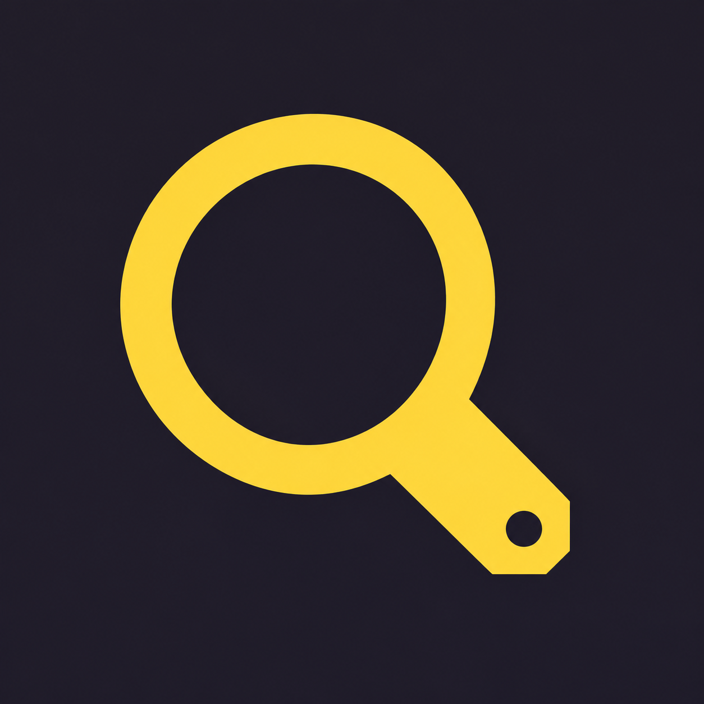

# Guia de design do Achadinhos Baratos

Este guia define a identidade visual para o perfil do Instagram, os vídeos de oferta e a vitrine. A paleta principal vem da vitrine atual. As medidas para novas artes são parâmetros de criação. [Guia editável no Canva](https://www.canva.com/design/DAHbHFXohag/RC9fYRCaz5RrBjEsMY4WzA/edit)

## Paleta principal

| Cor | HEX | Aplicação |
|---|---|---|
| Laranja | `#F04D27` | Identidade da marca, fundos de destaque, ícones e detalhes. |
| Laranja escuro | `#D53714` | Botões laranja com texto branco e links sobre fundo branco. |
| Amarelo | `#FFD84C` | Etiquetas de preço, desconto e chamadas principais, com texto em grafite. |
| Grafite | `#25232B` | Títulos, texto sobre fundo claro e placas de legenda com texto branco. |
| Creme | `#FFF8F3` | Fundo geral da vitrine, das capas claras e dos carrosséis. |
| Branco | `#FFFFFF` | Cards, superfícies e texto sobre grafite ou laranja escuro. |
| Cinza | `#6D6C76` | Informações secundárias, como a data em que o preço foi visto. |
| Verde | `#167B4E` | Confirmações e indicadores positivos acompanhados de texto. |

Use **grafite sobre amarelo** para preço e destaque. Nos botões laranja com rótulo branco, use o **laranja escuro**. O branco sobre o laranja principal tem contraste de 3,62:1, e o laranja escuro sobre branco chega a 4,79:1. Prefira a segunda combinação para texto de tamanho normal. [Paleta atual da vitrine](vitrine.css)

### Cores em uso nos vídeos

O gerador atual usa valores próprios. Em novas capas, templates e futuros ajustes do robô, use a paleta principal acima como referência.

| Elemento | Cor atual no robô |
|---|---|
| Laranja de destaque | `#FF5C28` |
| Amarelo de preço e palavra falada | `#FFD60A` |
| Fundo escuro de etiquetas e contornos | `#121016` |
| Vermelho do selo de desconto | `#E5262F` |
| Verde de indicadores | `#16B268` |
| Cinza do preço anterior | `#CDC8D7` |

[Constantes do gerador de vídeos](bot.py#L910)

## Tipografia

| Uso | Fonte | Peso |
|---|---|---|
| Preços, títulos de capa e chamadas | **Inter Display** | Black · 900 |
| Legendas do vídeo | **Inter Display** | Black · 900 |
| Benefícios, selos e rótulos | **Inter** | Bold · 700 |
| Datas, observações e texto corrido das artes | **Inter** | Regular · 400 ou Medium · 500 |

Se a ferramenta de criação oferecer apenas **Inter**, use a mesma família e mantenha os pesos. A vitrine atual usa fontes do sistema. O robô procura Inter Display Black e Bold, depois Inter e as fontes de reserva do ambiente. [Tipografia da vitrine](vitrine.css) · [Fontes do robô](bot.py#L919)

## Símbolo e foto de perfil

A **lupa com cabo de etiqueta** é o símbolo do Achadinhos Baratos. O aro remete à busca por ofertas e o furo no cabo remete à etiqueta de preço. Use a lupa em amarelo `#FFD84C` sobre fundo grafite `#25232B`.

A arte original tem 1254 × 1254 px. Para a foto de perfil, use a composição centralizada em uma arte quadrada de 1080 × 1080 px. Confira o recorte circular e a leitura em uma miniatura de 40 px. [Arquivo original em PNG](assets/identidade/lupa-etiqueta.png)

### Lupi nos vídeos

O robô usa o Lupi, o protótipo de lupa animada com aro turquesa, cabo roxo e tênis amarelos, como apresentador. [Desenho do Lupi no gerador](bot.py#L1385)

## Formatos de criação

| Peça | Proporção e tamanho | Área de atenção | Exportação |
|---|---|---|---|
| Foto de perfil | **1:1 · 1080 × 1080 px** | Símbolo no centro, com folga para o corte circular. | PNG |
| Reel e Short | **9:16 · 1080 × 1920 px** | Produto em destaque. Preço, legenda e chamada longe dos botões da direita e da faixa inferior. | MP4 · H.264 + AAC · 30 fps |
| Capa de Reel | **9:16 · 1080 × 1920 px** | Produto e título no miolo da arte. Confira o recorte da grade na prévia. | PNG ou JPG |
| Story | **9:16 · 1080 × 1920 px** | Reserve espaço no topo e na base para controles e figurinhas do app. | PNG, JPG ou MP4 |
| Post ou carrossel | **4:5 · 1080 × 1350 px** | Use a mesma proporção em todo o carrossel e mantenha texto e preço dentro das margens. | PNG ou JPG |

Para Reels de 1080 × 1920 px, use como ponto de partida uma área segura para **texto essencial** entre **x = 120 e 900 px** e **y = 220 e 1520 px**. Confira a prévia com os controles do aplicativo antes de exportar. [Resolução do robô](bot.py#L123) · [Layout atual do formato tela verde](bot.py#L1751)

## Composição por canal

### Reels e Shorts

- **Abertura.** Mostre o produto já no primeiro quadro. Traga um benefício específico ou o preço encontrado logo no começo.
- **Demonstração.** Priorize enquadramentos que mostrem tamanho, detalhes ou uso quando houver material real. O Lupi entra no canto esquerdo como apresentador.
- **Oferta.** Use o preço atual como o texto de maior destaque, em grafite sobre amarelo. Inclua preço anterior quando houver uma referência clara. Use o formato **R$ 31,98** e informe a data do preço quando pertinente.
- **Legenda.** Use branco sobre fundo escuro semitransparente. O amarelo pode destacar a palavra falada. Limite cada bloco a poucas palavras para acompanhar o ritmo da fala.
- **Fechamento.** Use uma chamada por vídeo. No Instagram, **“Veja o preço no link da bio”** direciona para a vitrine.

### Capas e carrosséis

Use uma foto clara do produto como elemento principal, título curto e uma etiqueta amarela se houver preço ou desconto para destacar. Trabalhe com fundo creme ou branco e um detalhe laranja para manter a unidade no feed. Como referência, use **até duas linhas de título**, margem de **72 px** em artes de 1080 px de largura e cantos de **24 a 32 px** em caixas e etiquetas.

### Vitrine

Mantenha fundo creme, cards brancos e cantos arredondados de **18 px**. A ordem de leitura do card deve favorecer **foto → produto → preço → botão**. Use o amarelo para o selo de desconto e mantenha o texto principal em grafite. No celular, confira se os cards ainda mostram o preço e a ação principal sem apertar os rótulos. [Estilos dos cards e layout responsivo](vitrine.css)
